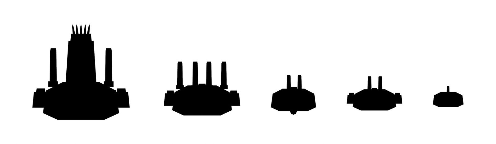
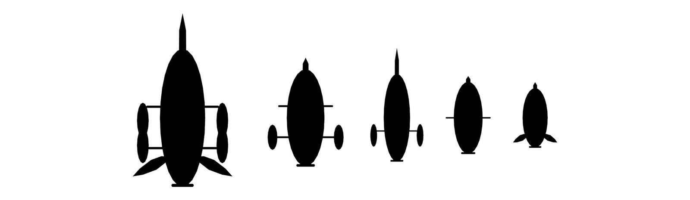
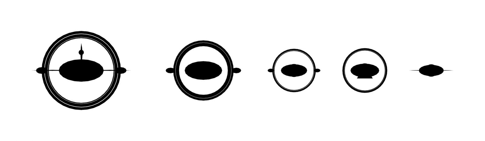
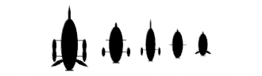

# Ship-design reference (Prompt 11)

A digital reference rendered from the models the game actually loads (`Assets/RR/Art/Models/*.fbx`), with no repainting or
retouching. It is **not** print-ready or manufacturing-ready geometry: the meshes are low-polygon game models with open seams,
overlapping parts and no wall thickness. There is no physical store or production pipeline, and none is implied.

Regenerate everything here with:

```bash
"/c/Program Files (x86)/Steam/steamapps/common/Blender/blender.exe" -b --factory-startup --python Tools/Blender/rr_mounts.py
"/c/Program Files (x86)/Steam/steamapps/common/Blender/blender.exe" -b --factory-startup --python Tools/Blender/rr_design_sheet.py -- <out dir>
```

`rr_mounts.py` measures the flagship hulls (ray casts at each module's station) and writes `Assets/RR/Game/ShipMounts.g.cs`;
`rr_design_sheet.py` renders the sheets below with the same measurement, so the reference and the game fit modules identically.

## Status of the art

All ten slice classes, the escort token and the three modules are **first-pass generated art** (`Tools/Blender/rr_ships.py`),
new interpretations of the faction references, pending the creator's approval (VS-18). They are not premium finished art; see the
asset-gap list in [STATE](STATE.md#asset-gaps).

## Silhouettes, to scale (flat black, top and side)

| | Top | Side | At battle-map size (96 px) |
|---|---|---|---|
| Pygmaei |  |  |  |
| Inhumanus |  |  |  |

Left to right: flagship, cruiser, destroyer, frigate, and the smallest class (Rift Interceptor; Mercator Corvette).

**Monochrome recognition.** At 96 px the two factions separate by outline alone: Pygmaei hulls are rectangular blocks with a ram
prow and a ragged stern of exhaust stacks; Inhumanus hulls are smooth ellipses with outrigger pods and rings standing off the hull.
**Within** a faction the classes separate mainly by size; the cruiser, destroyer and frigate of each faction share one outline
family. That is acceptable at the scale cue the battle map gives (models are scaled by class), but it is a gap for premium art.

Shaded, to scale: [Pygmaei](design/shaded_pygmaei.jpg), [Inhumanus](design/shaded_inhumanus.jpg).

## Flagship configurations: hull plus modules

Each flagship alone, then with each module fitted (one per slot; each a sidegrade, VS-21):

* Pygmaei Revenant Command Ship: [three-quarter](design/config_pygmaei_revenant_command_ship_3q.jpg), [top](design/config_pygmaei_revenant_command_ship_top.jpg)
* Inhumanus Executive Flagship: [three-quarter](design/config_inhumanus_executive_flagship_3q.jpg), [top](design/config_inhumanus_executive_flagship_top.jpg)

**Configuration identifiers.** A fitted ship is described by its hull id and module tokens, exactly as the army entry carries
them into battle and as the hangar shows them: for example `pygmaei_revenant_command_ship + module:afterburners`. Module ids:
`afterburners` (propulsion), `ablative_plating` (protection), `heavy_battery` (firepower).

**Hull and module separation.** Hulls and modules are separate meshes and separate FBX files (`module_<id>.fbx`). A module is
authored once for a hull of length 1 centred on the hull's bounds, then fitted per hull from measured data: lateral modules are
set against the hull's flank at their station, the dorsal battery on its spine. Nothing about a module is baked into a hull.

## What could inform future miniatures

Only design intent, not geometry:

* the **hull-plus-module split** with one module per slot, so a physical model could take a stern pod pair, flank plates or a
  dorsal turret as separate sprues on a common hull;
* **slot positions that are the same on every hull** (stern quarter, flanks amidships, dorsal spine), which suggests standard
  sockets rather than per-hull parts;
* **faction outline grammar** (blocky industrial versus smooth lenticular with standing rings) that survives at very small sizes.

The ring structures on Inhumanus hulls and the thin spikes on Pygmaei prows would not survive as physical parts without
redesign. The current modules are generic (Pygmaei-styled plating and stacks on both factions), which a miniature line would not
want.
